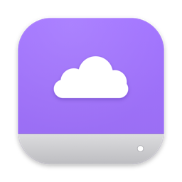
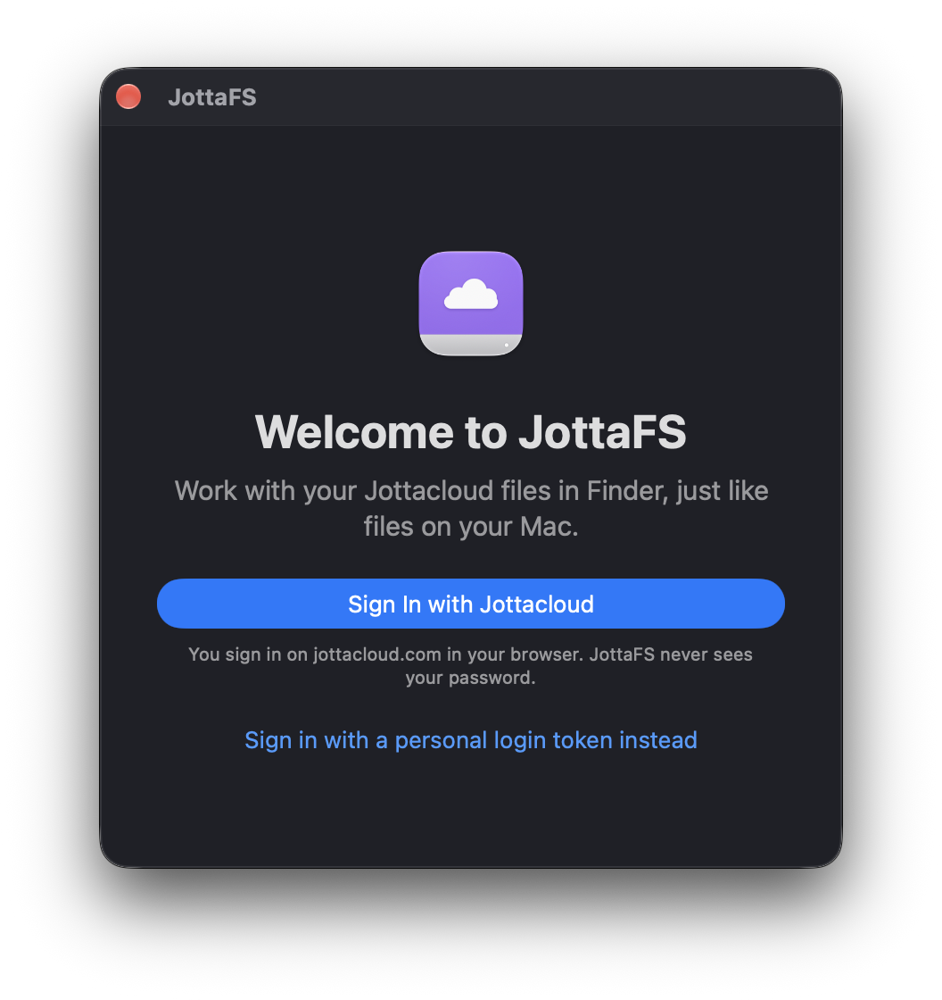
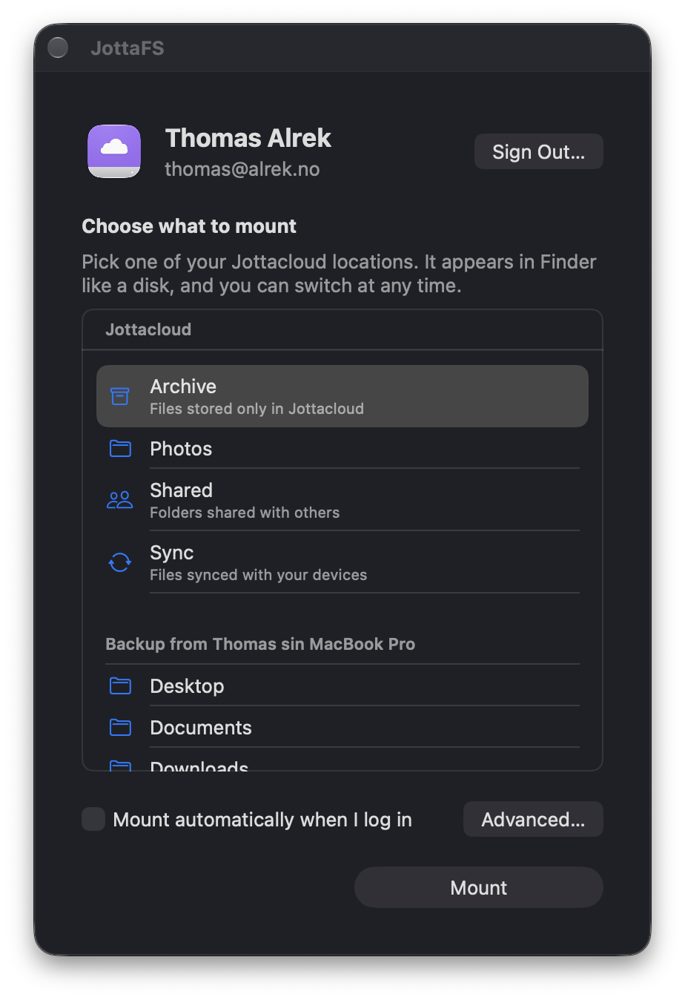
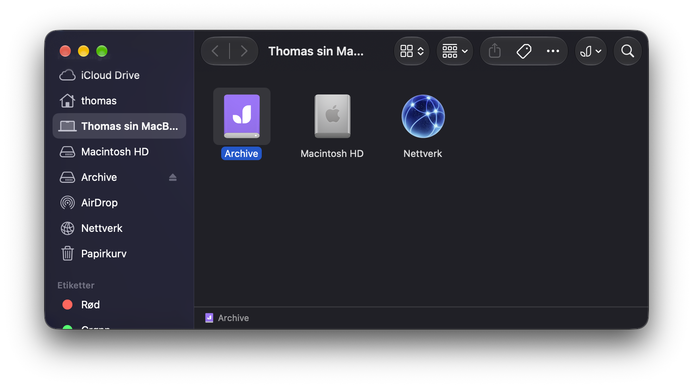

<p align="center">
  
</p>

<h1 align="center">JottaFS</h1>

<p align="center">
  Use your Jottacloud files in Finder on your Mac, as a disk.
</p>

<p align="center">
  
  
  
</p>

JottaFS is a macOS app and file system extension. It connects to your
Jottacloud account and shows your Jottacloud locations in Finder as disks.
You can open, copy, change, move and delete files on these disks. JottaFS
sends the changes to Jottacloud.

<p align="center">
  <a href="https://github.com/thomas-alrek/JottaFS/releases/latest">
    
  </a>
  <br>
  <a href="https://github.com/thomas-alrek/JottaFS/releases/latest">Download the latest version (.dmg)</a>
</p>

JottaFS uses Apple FSKit. It does not use macFUSE or a kernel extension.

> [!IMPORTANT]
> JottaFS is not an official Jottacloud product. Jottacloud AS does not make,
> support or approve it. JottaFS uses Jottacloud interfaces that do not have
> public documentation. These interfaces can change at any time.

## Screenshots

<p align="center">
  
  &nbsp;
  
</p>

<p align="center">
  
  <br>
  <em>The mounted location in Finder, as a disk next to Macintosh HD.</em>
</p>

## Contents

- [Features](#features)
- [Requirements](#requirements)
- [Install](#install)
- [Use JottaFS](#use-jottafs)
- [The Trash](#the-trash)
- [Limits](#limits)
- [Troubleshooting](#troubleshooting)
- [Privacy and security](#privacy-and-security)
- [How JottaFS works](#how-jottafs-works)
- [Development](#development)
- [Documentation](#documentation)
- [License](#license)

## Features

- **Sign in with your browser.** You sign in on jottacloud.com. JottaFS does
  not see your password.
- **Sign in with a personal login token.** Use this method if you do not want
  to sign in with your browser.
- **Mount locations as disks.** Select Archive, Sync, Shared, Photos or a
  folder from a computer backup. Each location shows in Finder as a disk
  with the same name. You can mount more than one location at the same time.
- **Read and write files.** Open, copy, change, rename, move and delete files
  and folders.
- **Upload progress in Finder.** The file icon shows a progress bar during the
  upload. A Finder copy is complete only when the upload is complete.
- **Resume uploads.** If the network connection stops during an upload,
  JottaFS tries again and continues from the last saved part.
- **Trash.** Move to Trash, Put Back and Empty Trash work with the Jottacloud
  trash. Refer to [The Trash](#the-trash).
- **Mount at login.** JottaFS can mount the locations that you select
  automatically when you log in. No window opens.
- **Custom disk name.** Control-click a location and choose **Rename** to
  give its disk a different name in Finder.
- **Backup devices.** Create a backup device, the same kind that holds the
  backup of a computer, and add locations to it or to any other backup
  device. Move a location to the Jottacloud trash, or delete a whole backup
  device. Refer to [Backup devices and locations](#backup-devices-and-locations).
- **Updates.** JottaFS tells you when a new version is available. Click
  **Update** to install it. JottaFS opens again with the new version.
- **Fast folders.** JottaFS keeps folder lists for a short time. Large folders
  open quickly.
- **Share links from Finder.** Control-click a file or folder on a
  Jottacloud disk and choose **Copy Jottacloud Link**. For a shared item,
  **Stop Sharing Jottacloud Link** removes the link. Turn on the Finder extension once: JottaFS
  asks, or use **JottaFS → Settings**.
- **Sidebar icon.** Jottacloud disks show a drive icon in the Finder
  sidebar, the same as Macintosh HD.
- **No clutter on Jottacloud.** Finder's own files stay on your Mac: the
  view settings of folders (`.DS_Store`) and the `._` files that hold
  Finder tags, comments and download information. These settings are kept
  on this Mac only, so other devices do not see them. macOS keeps no
  file-event log on Jottacloud disks.
- **English and Norwegian.** JottaFS uses Norwegian (Bokmål) when Norwegian
  is in your preferred languages in **System Settings → General → Language &
  Region**. Otherwise it uses English. In Norwegian, Archive, Sync, Shared and
  Photos show as Arkiv, Synk, Delt and Bilder, also as the disk names.
- **Download cache.** JottaFS keeps recently downloaded file data on your Mac
  (1 GB by default). Files that you open again open immediately. Change the
  size in **JottaFS → Settings**. JottaFS deletes the data of a disk when you
  unmount it, and all of it when you restart your Mac.

## Requirements

- A Mac with Apple silicon and macOS 27 or later. Earlier versions of macOS
  do not have the FSKit functions that JottaFS uses to mount a disk (see
  [FSKit notes](docs/fskit-internals.md#extension-model)).
- A Jottacloud account.
- To build JottaFS: Xcode with the macOS 27 SDK, and an Apple Developer team.
  The FSKit extension must have a signature.

## Install

### Download

1. Download `JottaFS-<version>.dmg` from the
   [latest release](https://github.com/thomas-alrek/JottaFS/releases/latest).
2. Open the DMG and drag **JottaFS** to **Applications**.
3. Open JottaFS from Applications.

### Install with Homebrew (optional)

The JottaFS repository is also a Homebrew tap. Add the tap one time:

```sh
brew tap thomas-alrek/jottafs https://github.com/thomas-alrek/JottaFS
```

Then install JottaFS:

```sh
brew install --cask thomas-alrek/jottafs/jottafs
```

JottaFS updates itself. To update with Homebrew instead, use
`brew upgrade --cask jottafs`. To remove JottaFS, unmount your disks first,
then use `brew uninstall --cask jottafs`.

### Build from the source code

1. Clone the repository:

   ```sh
   git clone https://github.com/thomas-alrek/JottaFS.git
   ```

2. Open `JottaFS.xcodeproj` in Xcode.
3. For each target, select your team in **Signing & Capabilities**.
4. Select the **JottaFS** scheme. Then select **Product → Run**.
5. Move the app to the `Applications` folder if you want to mount at login.
   macOS starts login items from a fixed location.

### Turn on the file system extension

macOS must allow the JottaFS extension one time.

1. Open **System Settings**.
2. Go to **General → Login Items & Extensions → File System Extensions**.
3. Turn on **JottaFS**.

The JottaFS app tells you when you must do this. The app finds the change
automatically.

### Allow upload progress (optional)

JottaFS uses a small background helper to show upload progress on file icons
in Finder. If macOS asks, allow **JottaFS** in **System Settings → General →
Login Items & Extensions**.

This step is optional. Without the helper, all functions work. The only
difference is that the progress bar on a file icon does not move during the
upload. It shows the upload as complete at the end.

## Use JottaFS

### Sign in

1. Open JottaFS.
2. Click **Sign In with Jottacloud**. Your browser opens jottacloud.com.
3. Sign in to Jottacloud. The browser tab closes, and JottaFS shows your
   account.

To sign in with a personal login token:

1. Click **Sign in with a personal login token instead**.
2. Click **Open** to open the Jottacloud security settings.
3. Under **Personal login token**, click **Generate**. Copy the token.
4. Paste the token into JottaFS. Click **Sign In**.

You can use a token one time only. JottaFS keeps you signed in after that.
You do not need to keep the token.

### Mount a location

1. Select a location in the list. Locations from a computer backup show under
   the name of the computer.
2. Click **Mount**, or double-click the location.

The location shows in Finder as a disk, and a green checkmark shows next to
it in the list. JottaFS opens it in a Finder window. To mount more
locations, select a different location and click **Mount** again.

### Give the disk a different name

1. Control-click the location in the list and choose **Rename**.
2. Type a name in **Name in Finder**. Then click **Rename**.

If the location is mounted, the disk gets the new name the next time you
mount it. To use the name of the location again, delete the name and click
**Rename**.

### Backup devices and locations

Jottacloud keeps the backup of each computer as a *backup device* with one
location for each backed-up folder. You can make backup devices of your own
and use their locations as disks. They show under **Backup** on
jottacloud.com.

- **New backup device:** click **+** in the toolbar of the window, or choose
  **File → New Backup Device**. Type a name for the
  backup device and for its first location (a backup device needs at least
  one location). Then click **Create**. JottaFS selects the new location, so
  you can mount it at once.
- **New location:** click **+** in the header of a backup device in the list,
  or Control-click one of its locations and choose **New Location**.
- **Move a location to the trash:** Control-click the location and choose
  **Move to Trash**. The location and its files move to the Jottacloud trash.
  You can restore them on jottacloud.com.
- **Delete a backup device:** click **…** in the header of the backup device
  and choose **Delete Backup Device**. The backup device, all its locations and all their files
  are deleted permanently. They do not go to the Jottacloud trash and you
  cannot restore them.

A mounted location is unmounted first. If it cannot be unmounted (for
example, a file on the disk is open), nothing is removed. Jottacloud's own
locations (Archive, Sync, Shared and Photos) cannot get new locations and
cannot be removed.

### Unmount

Do one of these steps:

- In JottaFS, select the location and click **Unmount**. Then click
  **Unmount** again to confirm.
- In Finder, click **Eject** next to the disk.

Close all files on the disk before you unmount it. Your files stay in
Jottacloud.

### Mount at login

Select a location, then select **Mount at login**. Do this
for each location that you want to mount at login. When you log in, JottaFS
waits for the network connection, mounts these locations and closes. No
window and no Dock icon open. If a mount still fails after 3 minutes,
JottaFS opens its window and shows the problem.

JottaFS uses a background item for this. If macOS asks, allow **JottaFS** in
**System Settings → General → Login Items & Extensions**.

### Menu commands

The **File** and **Location** menus have the same actions as the context menu
of a location: New Backup Device (Shift-Command-N), New Location
(Command-N), Mount or Show in Finder (Command-O), Unmount (Command-E), mount
at login, Rename, Move to Trash (Command-Delete) and Delete Backup Device.
They act on the location that is selected in the list.

### Settings

Click the gear button in the upper-right corner of the JottaFS window, or
choose **JottaFS → Settings**.

- **Account:** your name and email, and **Sign Out**.

- **Download cache:** set the size of the download cache, see how much of it
  is in use, and click **Clear Cache** to delete it.
- **File System:** the switch shows if the JottaFS file system extension is
  on. Click it to open **File System Extensions** in System Settings.
- **Finder:** the switch shows if the Finder extension is on. It adds
  **Copy Jottacloud Link** to Finder. Click it to open the Finder extensions
  in System Settings.

macOS does not let an app turn its extensions on or off. Make the change in
System Settings; the switch in JottaFS then shows it.

- **Updates:** turn **Check for updates automatically** off if you do not
  want JottaFS to check for new versions.

### Update JottaFS

JottaFS checks for a new version when it opens and one time each day (you
can turn this off in Settings). While JottaFS is closed, it checks about
every 12 hours in the background and shows a notification when there is a
new version. Click the notification to open JottaFS. When
there is a new version, JottaFS shows it at the top of the window.

1. Click **Update**. JottaFS downloads the new version.
2. JottaFS installs the new version and opens again.

If JottaFS cannot connect to GitHub, it tries again later. It does not show an
error.

### Sign out

Open **Settings**, click **Sign Out**, then click **Sign Out** again to
confirm. JottaFS unmounts
all mounted locations first. Then it signs out on Jottacloud and deletes the
saved sign-in from your Mac. Your files stay in Jottacloud.

On jottacloud.com, **Settings → Security** shows JottaFS in the list of
signed-in devices, with the name of your Mac. If you remove JottaFS there,
or if Jottacloud ends the sign-in, JottaFS unmounts your disks and asks you
to sign in again.

JottaFS keeps your sign-in active: macOS opens JottaFS without a window two
times a day for a moment. You can see this item in **System Settings →
General → Login Items & Extensions**.

## The Trash

Finder's Trash shows the items in the Jottacloud trash that come from the
mounted location.

| In Finder | In Jottacloud |
|---|---|
| **Move to Trash** | Moves the item to the Jottacloud trash. |
| **Put Back** | Restores the item to its original location. |
| **Delete Immediately** | Deletes the item permanently. |
| **Empty Trash** | Deletes all items in the Trash of this disk permanently. |
| `rm` in Terminal | Deletes the item permanently, as on a local disk. |

> [!WARNING]
> **Empty Trash** also deletes items that you moved to the trash on
> jottacloud.com or on a different device, if they come from the mounted
> location. You cannot restore permanently deleted items.

Before JottaFS deletes an item permanently, it makes sure that the item is in
the Jottacloud trash. JottaFS never deletes a file that is not in the trash.

## Limits

- You cannot rename the disk in Finder. Control-click the location in
  JottaFS and choose **Rename** instead.
- A backup device without locations does not show in JottaFS, because
  Jottacloud lists a backup device only when it has a location. If you move
  the last location of a backup device to the trash, the backup device stays
  in Jottacloud. To remove it too, delete the backup device instead.
- You cannot open files that are in the Trash.
- Symbolic links and hard links are not supported.
- Jottacloud stores no file permissions, so every file on a Jottacloud disk
  can be run, like on a USB drive with the FAT or exFAT format. Apps, scripts
  and tools on the disk open as usual. Finder shows files without a file
  extension (such as `README`) as Unix executables, and opens them in
  Terminal.
- Names with the characters `" * : < > ? | % \` cannot be used, because
  Jottacloud cannot store them. Finder then shows "an unknown error
  occurred (error code -50)", and JottaFS shows a notification with the
  names of the items. Images that you save from websites often have a `?`
  in the name. Rename the file, then copy it again.
- JottaFS keeps a full copy of a file on your Mac before the upload starts.
  Jottacloud must know the checksum of the complete file before the upload.
  Your Mac must have free space for the file that is uploading. JottaFS
  deletes its copy when the upload is complete (never the file that you
  copied from). When you copy many files, your Mac needs free space for the
  largest file only. If your Mac has not enough free space for a file,
  JottaFS first deletes data from its download cache. If that is not
  sufficient, the copy stops with the error "not enough free space". When
  you copy with Finder or `cp`, this happens at once, before the file is
  written.
- The **Get Info** window shows the format as "Unknown (jottacloud)".
- Finder does not show changes that you make on jottacloud.com or on a
  different device until it reads the folder again. Close and open the
  folder, or unmount the disk and mount it again. In Terminal, `ls` shows
  the changes after approximately 15 seconds.

## Troubleshooting

**"Turn JottaFS off and on in System Settings", or "JottaFS couldn't mount
the location" with `com.apple.extensionKit.errorDomain error 2`.** More than
one copy of JottaFS is on your Mac (for example an old copy, or a build from
Xcode), and macOS uses the extension of a different copy. JottaFS shows the
first message, with the path of the other copy, when it finds this. Your
disks then do not get the changes of the JottaFS version that you use.

1. Quit JottaFS. Delete the other copies of JottaFS, and empty the Trash.
2. Quit System Settings. Then open **System Settings → General → Login Items
   & Extensions → File System Extensions**, and turn **JottaFS** off and on.
3. Open JottaFS from Applications and mount again.

If the problem continues, restart your Mac.

**The sidebar shows an old icon for a disk, not the drive icon.** Finder
keeps the old icon after an update. Relaunch Finder: hold Option,
Control-click the Finder icon in the Dock and choose **Relaunch**.

**Time Machine lists the Jottacloud disks.** Time Machine cannot back up to
a Jottacloud disk: it needs a disk with a device, or a network share with
Time Machine support. Its settings still show the disks in the list of
backup disks. If you choose one, Time Machine shows an error, also if you
confirm to erase it; your files stay as they are. JottaFS tells Time
Machine not to ask if you want to use a Jottacloud disk when it is mounted.

**The location list is disabled.** Turn on **JottaFS** in **File System
Extensions** (step 2 above). JottaFS finds the change automatically.

## Privacy and security

- JottaFS sends data only to Jottacloud: `id.jottacloud.com`,
  `api.jottacloud.com`, `jfs.jottacloud.com`, `grpc.jotta.cloud` and the
  upload hosts that Jottacloud gives for each upload.
- Browser sign-in uses OAuth 2.0 with PKCE. The browser returns to JottaFS
  through a temporary address on your Mac (`localhost`).
- JottaFS keeps the sign-in tokens in a private file in the app group folder
  on your Mac. Only JottaFS and its extensions can read this file.
- JottaFS sends the name of your Mac to Jottacloud, so that your list of
  signed-in devices on jottacloud.com shows it. Change the name in **System
  Settings → General → About**.
- JottaFS does not write tokens to logs.
- The app and the extension run in the macOS App Sandbox.

## How JottaFS works

| Part | Function |
|---|---|
| `JottaFS` (app) | Sign-in, location list, mount and unmount, mount at login. |
| `JottaFSKitExtension` | The FSKit file system. It shows the location and does all file operations. |
| `JottaFSCore` | The Jottacloud client: sign-in, folder lists, downloads, uploads and the trash. |
| `JottaFSService` | An XPC service outside the App Sandbox that unmounts disks and installs updates. Included by default. A fully sandboxed build (`make sandboxed`) leaves it out; then you eject the disks in Finder and update JottaFS yourself. |
| `JottaFSFinderSync` | A Finder extension: **Copy Jottacloud Link** and **Stop Sharing Jottacloud Link** for items on JottaFS disks. |
| `JottaFSProgressAgent` | A background helper that shows upload progress on file icons in Finder. |
| Login agent | Starts JottaFS at login to mount the locations that you selected. |
| Refresh agent | Starts JottaFS without a window two times a day to keep the sign-in active. |

## Development

Build the extension code and run the checks and regression tests:

```sh
make check
```

With a build installed and a location mounted, the live write probe checks
copies, downloads and attributes on the real volume (in `JottaFS-Test`):

```sh
make probe VOLUME=/Volumes/<disk name>
```

The app icon is the layered Icon Composer file `Resources/JottaFS.icon`
(open it in Icon Composer, which comes with Xcode). `Tools/make-app-icon.swift`
draws the flat `Resources/JottaFS.icns` that the DMG uses as its disk icon.
For the screenshots in this README, a Debug build can start at the sign-in
screen without signing out: run it with `--preview-signed-out`.

These commands do not make or sign the app. Use Xcode to build, sign and test
the app and the extension.

After you change the extension:

1. Unmount the disk.
2. Build the app in Xcode.
3. Mount the disk again.

If macOS does not show the new extension, turn **JottaFS** off and on in
**File System Extensions**. If that does not help, restart your Mac.

### Translations

The texts are in String Catalogs (`Localizable.xcstrings`): one for the app
(`HostApp`), the Finder extension, JottaFSService and the JottaFSCore
framework (its error messages). English is the development language and the
fallback; Norwegian is `nb`. Xcode adds new texts to the catalogs when it
builds. Add the Norwegian text for each new text before a release. Write
"Aktiver / Deaktiver" for mount and unmount (as in Disk Utility).

> [!CAUTION]
> Your Jottacloud account contains your own files. Test changes only on files
> that you make for the test.

## Documentation

- [Jottacloud API research](docs/jottacloud-api-internals.md)
- [FSKit notes](docs/fskit-internals.md)
- [Write support design](docs/write-support-design.md)
- [Trash design](docs/trash-design.md)
- [Releasing](docs/releasing.md)

## License

JottaFS is available under the [MIT License](LICENSE).

Jottacloud is a trademark of Jottacloud AS.
